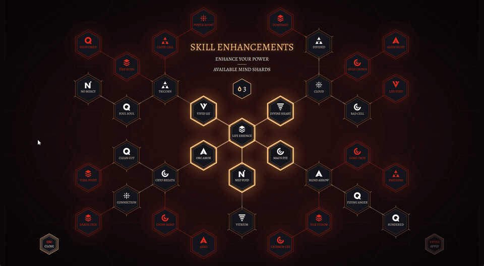

# Skill Tree (NoesisGUI + C++)

Recreación en Noesis del concepto de UI *Skill Tree* de Łukasz Wronka (ArtStation `6NGdvn`).
La disposición, los estados y la paleta (`#13141B`, `#D6281C`, `#FFC582`, `#FFFFFF`) siguen la
hoja del concepto. Los íconos son glifos propios, no los del artista.



```
skill-tree-concept/
├── C++/
│   ├── Data/       MainPage.xaml, Resources.xaml, Fonts/Alegreya.ttf
│   ├── Src/        Main.cpp (launcher), ViewModel.h/.cpp (nodos, enlaces, reglas)
│   └── Projects/   windows_x86_64/SkillTree-vs2026.vcxproj
└── tools/gen_hex_grid.py   genera el path de la grilla de fondo
```

## Compilar y correr

Requiere el SDK nativo de Noesis 4.0 en `C:\NoesisGUI-SDK\` (o pasar `-p:NoesisRoot=...`) y
Visual Studio 2026 (toolset v145). Igual que GameMenu, el proyecto es standalone.

```powershell
cd C++\Projects\windows_x86_64
msbuild SkillTree-vs2026.vcxproj -p:Configuration=Release -p:Platform=x64
C:\NoesisGUI-SDK\Bin\windows_x86_64\SkillTree.exe
```

Los XAML y la fuente se embeben con `bin2h`: tras editar un `.xaml` hay que recompilar.

## Cómo se juega

| Estado (hoja) | En código   | Se ve                                   |
|---------------|-------------|-----------------------------------------|
| LOCKED        | `Locked`    | rojo; ningún vecino adquirido           |
| UNLOCKED      | `Available` | blanco con marco fino; se puede comprar |
| SELECTED      | `Pending`   | borde dorado que respira; reembolsable  |
| SELECTED      | `Owned`     | borde dorado fijo; confirmado           |

- Clic en un nodo disponible: lo compra con *mind shards* (3 al inicio; costo 1 o 2).
- Clic en un nodo `Pending`: lo reembolsa, y en cascada todo lo que dependía de él.
- **ENTER / APPLY**: confirma lo pendiente. **ESC**: con algo pendiente lo descarta
  (el botón dice CANCEL); sin nada pendiente cierra la app.

## Animaciones de desbloqueo

Todas en `Resources.xaml`, disparadas por `DataTrigger` sobre `State`:

- **Revelar** (Locked → Available): el rojo se apaga, la tinta vira a blanco, onda dorada y pop.
- **Adquirir** (→ Pending): destello, doble onda expansiva, pop elástico y halo que respira.
- **Aplicar** (→ Owned): destello corto y anillo que se contrae, como un sello.
- **Enlace activo**: la energía recorre la línea (`StrokeDashOffset`) y queda encendida.
- **Denegado** (bloqueado o sin shards): shake con anillo rojo y destello del contador.

Cada storyboard de estado fija *todas* las capas, así cualquier transición (incluido un
reembolso) anima desde donde esté el nodo.

> Los halos son `RadialGradientBrush`, no `BlurEffect`: con un blur por nodo se agotaba el pool
> de render targets offscreen de Noesis y aparecían bloques naranjas en pantalla.

## Licencias

- Alegreya: SIL Open Font License 1.1 (Huerta Tipográfica), copiada de `GearSlot/Assets/Fonts`.
- Concepto visual: Łukasz Wronka. Uso de estudio, no comercial.
